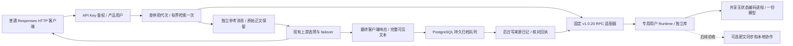

# Sub2API 服务端 Respire 记忆实施方案

更新：2026-11-07（Asia/Shanghai）。服务端文本 MVP 已完成 unit、PostgreSQL component 和真实生产 Runtime 验收。全站默认开通已获用户授权，新增独立 Runtime 供应和绑定清单热加载；实际已发布范围、版本和回滚点以 [DEPLOYMENT.md](DEPLOYMENT.md) 为准，实现审阅见 [RESPIRE_INTEGRATION_REVIEW.md](RESPIRE_INTEGRATION_REVIEW.md)。

## 产品方向

Sub2API 根据鉴权所得的产品用户账号提供检索、上下文注入和异步来源归档；同一用户跨 API Key、客户端、模型及上游复用记忆。普通用户无需安装本地 Respire，本地端后续作为可选协作层。服务器已有的密文同步 Server 与可读写记忆的 Runtime 是不同组件。

产品默认向全站活跃账号开通，不要求本地安装插件；用户主动停用仍保留。用户 1 保留原有 M3 独立库；新增账号的独立库通过 `host_transport/openai_embeddings` 共用一个 CPU 编码进程和模型权重，不再每账号加载一个 ONNX 模型。固定版 Runtime 绑定单库，因此各账号仍有轻量进程、独立 OS 用户、密钥、库和 loopback 端口；编码器没有记忆库、账号密钥或文本缓存，不记录请求正文。

`deploy/provision-account-memory.py` 完成健康、库身份和共享模型准备后原子发布 `memory.bindings_file`；定时服务每分钟检查新增活跃账号，网关每 5 秒加载已准备的新增绑定。供应失败不假报开通，也不重绑现有账号。已准备的轻量模型库可用 `--reconcile-bindings` 切到共享编码，静态绑定不参与迁移。具体安装及核验步骤以 [DEPLOYMENT.md](DEPLOYMENT.md) 为准。

共享模型基于量化 `bge-small-zh-v1.5`，512 维；长文本以 510 个内容 token 的完整窗口编码，按窗口长度加权并归一化，独立模型标识 `sub2api-bge-small-zh-windowed-v1` 将此策略纳入索引身份。每段最多 8192 token、批次最多 16 段及 16384 token，超限返回错误，不静默截断。该策略与原生 M3 不等价，当前没有两者回答质量比较。资源仍随轻量账号进程、数据量和检索并发增长，不能据此承诺当前 4 GB 主机适用于任意用户规模。

## 已实现的调用链



| 模块 | 代码 | 当前行为 |
| --- | --- | --- |
| 身份、预算与来源契约 | `backend/internal/service/memory_provider.go` | namespace 固定为 `sub2api_user:{user_id}`；预算、UTF-8 和来源定位校验 |
| Respire 适配 | `backend/internal/service/memory_respire.go` | 固定稳定协议；health、PID、库路径、RPC 和业务回执校验；主记忆与有界日记检索 |
| 归档队列 | `backend/migrations/250_memory_archive_queue.sql`、`internal/repository/memory_archive_repo.go`、`internal/service/memory_archive.go` | 事件去重、载荷摘要、租约 fencing、有限重试、未知结果核对及原文清理 |
| 网关接入 | `backend/internal/handler/memory_responses.go`、`openai_gateway_handler.go` | 一次检索注入；观察协议转换后的最终响应；完成后有界落盘 |
| 用户控制 | `backend/internal/server/routes/gateway.go`、`middleware/api_key_auth.go` | 本用户状态、事件查询、永久停用；无需模型额度仍可访问控制接口 |
| 配置与生命周期 | `backend/internal/config/memory.go`、`cmd/server/main.go`、Wire 组装 | 配置校验；完整初始化成功后启动 worker；统一退出清理 |

### 文字协议支持范围

首期接入 `POST /v1/responses` 的 HTTP 纯文本请求，包括普通 JSON 和 SSE 回答。支持字符串 input 或文本 message 数组；以最新用户文本检索并归档本轮来源。

普通工具调用/结果、媒体、`previous_response_id`、`conversation`、`context_management` 的请求，以及 compact、WebSocket 和其他协议入口，继续按既有转发行为处理，不参与本轮记忆闭环。既有合法 Codex automation/delegation bootstrap 会先规范化为用户文字，再按文字路径判定。虽然 Responses 的上游可经过协议转换，这不表示 `/chat/completions` 或 `/messages` 入口已经接入记忆。

响应采集以下游响应 writer 接受的最终响应字节为依据，结合断连和终态判断，不能保证网络最终送达。只有明确 `completed`、正文完整且无断连/错误/取消的纯文本回答才入队。隐藏推理不采集，工具输出不作为纯文本成功回答归档。超长、损坏或含歧义重复键的 JSON，以及不完整 SSE，不假报已保存；观察器不修改转发字节。

### 检索与注入

用户身份只取自 API Key 鉴权上下文，不从请求正文或自报 header 取值。`ProjectID`、`ConversationID` 不改变租户键；当前稳定适配器只实现用户全局范围，项目范围请求会明确拒绝，项目专属记录不混入全局结果。

检索包含前后两次用户代次检查，总超时默认 300 ms。引擎故障、超时或非法结果不会中断正常模型转发；后续入队仍独立检查用户状态。语义索引未就绪、预算截断等情况标记为不完整，不伪装为完整语义检索。

召回内容以 JSON 来源参考放入最新用户消息前的独立 user 消息，保留 instructions 和原始用户文本。包装中包含条目 ID、来源、日记 fragment ID / source version / Unicode 范围（若有）；文字明确为可能过期的历史资料。此提示约束不构成模型绝对不会受错误记忆影响的保证。

snippet 与完整参考包装均受条数、字节及保守 token 预留限制，另留 128 个单位用于消息 framing。一 UTF-8 字节一预留单位用于 byte-level BPE 文本预算，不是任意 tokenizer 的精确计数。超大候选跳过后继续选可用条目。

检索注入位于 failover 循环外；每次上游尝试复用同一正文快照。会话哈希、Grok 缓存身份和 WS 执行范围使用保留的原始正文；费用预留使用注入后的正文。缓存身份稳定不证明真实提示前缀命中，缓存收益仍需实际用量实验。

### 当前归档是来源日记

worker 将本轮用户文字和助手可见文字写为 Respire `trivial/context` 来源日记，明确区分 `user_statement` 与 `model_response_unverified`，带稳定事件来源和内容摘要。写入回执与 `show` 读回均核对后，队列才记为 `completed`。

这一步没有调用 LLM 提炼，也没有自动创建 important 主记忆。日记可通过有界 `diary-search` 参与后续检索；助手生成内容仍是未验证的模型回答。后续长期结论提炼需增加独立内部模型调用、证据分类和正确归类，避免递归走记忆流水线。

网关为一次实际请求生成 UUID，返回 `X-Sub2API-Memory-Event-Id`。同一次请求的所有上游尝试共用它；队列以 `(user_id, event_id)` 去重，同键不同载荷拒绝。独立客户端重发会产生新事件，目前没有跨 HTTP 重发的客户端幂等协议。

持久状态包括 `pending`、`processing`、`submitted`、`retry_wait`、`needs_reconciliation`、`completed`、`failed`、`cancelled`。worker 在外部写入前先持久化 `submitted`；租约失效后的 submitted 只进入核对。只有明确的提交前临时故障才自动重试；未知写入先查 `runtime.result` 和读回，不盲目重放。核对次数有限，耗尽后保留待人工核对状态。

worker 只能领取及维护本实例已验证绑定中的用户任务；静态绑定来自 `memory.bindings`，新增供应来自 `memory.bindings_file`。空范围不领取，非法用户范围拒绝；worker 每次领取读取 provider 的绑定快照，与请求准入一致。多个实例共享数据库、各自绑定不同用户时，不能抢走其他实例的任务并将其误判失败。已有用户的库/端口不允许热更换，清单缩减不撤销已加载绑定；用户停用由数据库 fence 执行。

每用户最多 1000 个未解决事件。完成、失败、取消后清除队列原文；其他原文在负责该用户的 worker 执行 Claim 维护时受 7 天保留期限制，停机或移除该用户绑定后不承诺定时执行清理。先恢复失效租约，再检查保留期，避免恢复任务绕过清理。完成回执和摘要仍保留，当前没有回执表容量清理功能。

回答已送出后只做有界数据库入队，默认 500 ms，不在请求线程调用归档模型或同步写引擎。数据库故障或队列满会记录失败；事件 header 只提供关联标识，不是入队或记住的成功回执。回答完成与归档成功是两个状态，未承诺每个已返回回答必定归档。

### 停用与删除边界

停用会永久阻止该用户的新检索和后续入队，增加代次，取消其排队任务并清除队列原文；旧租约不能提交队列成功状态。当前没有自动解除停用 API。

已提交给 Runtime 的操作仍可能在停用后物理完成，已被上游接收的参考上下文也无法追回。停用接口返回 `physical_deletion_confirmed: false`。provider 虽有核对回执的单条 `forget` 方法，产品层尚无单条删除 tombstone、关联事件失效、清空库或云/本地副本删除协议，因此不开放“全部删除”接口。

## 部署配置与操作

配置示例位于 `deploy/config.example.yaml`。以下只展示记忆段；ID、端口和库目录必须来自实际专用部署，不能直接复用站长个人库：

```yaml
memory:
  enabled: true
  bindings_file: "/etc/sub2api/memory-bindings.json"
  bindings:
    - user_id: 42
      base_url: "http://127.0.0.1:15170"
      data_dir: "/srv/sub2api-memory/user42/accounts/server/default"
  recall_timeout_ms: 300
  archive_timeout_ms: 120000
  enqueue_timeout_ms: 500
  poll_interval_ms: 1000
  lease_seconds: 180
  max_attempts: 3
  max_items: 8
  max_bytes: 8192
  max_tokens: 2048
  capture_max_bytes: 262144
  max_response_bytes: 1048576
```

启动前必须准备固定版 Runtime、独立已解锁的测试库、数据库迁移和有效产品用户。`base_url` 仅允许带明确端口的数字 loopback IP HTTP origin；每个用户必须独占端口和规范绝对库目录。`data_dir` 要与 health 返回的实际库路径一致。RPC 排队等待不超过检索超时、归档超时和 250 ms 三者的最小值。租约必须长于归档超时至少 5 秒，worker 还会计入持久化时间预留。

稳定 Runtime 不提供原子的租户 admission，health 到实际操作之间仍有状态变化窗口。部署期间不得切换其账户或库；必须由宿主提供目录、凭据、进程和端口访问的隔离边界。配置校验和 health 检查不能代替这些边界。不同用户共享同一 Runtime 或个人库不属于受支持方案。

普通 API Key 通过以下接口控制自己的记忆，无需提供目标 user_id：

| 方法与路径 | 含义 |
| --- | --- |
| `GET /v1/sub2api/memory` | 查询配置和停用状态；`runtime_health_checked: false` 明确不代表 Runtime 在线 |
| `GET /v1/sub2api/memory/events/{event_id}` | 查询该用户事件；他人或不存在事件为 404 |
| `POST /v1/sub2api/memory/suspend` | 永久停用本部署中的记忆；不会确认物理删除 |

这些控制接口保留密钥真实性、用户有效状态、Key 关联分组有效及授权等鉴权，不经过模型白名单或目标分组路由，不受余额、订阅或密钥计费额度/到期限制；已禁用的用户仍不可访问。日志只记有限诊断码、事件和耗时，不输出请求正文或原始引擎错误。用户主动粘贴在对话中的敏感内容仍可能进入来源日记，当前没有自动脱敏承诺。

首个上线验收使用专用用户及合成资料：普通客户端完成请求，查到 completed 事件和真实日记；同用户换 Key/模型后能检索同一来源；另一用户不能访问；再验证断流、引擎停止、写入回复丢失和停用。每项都需要真实依赖证据，当前测试 fixture 不能替代。

## 已核验的 Respire 约束

- 稳定 CLI `v1.0.20`，commit `26ead1ecf5c1a41e6d5e518aeb375e896f6c4c9e`；适配器只使用该版 RPC v1：`GET /api/health`、`POST /api/rpc`、`cli.exec` 参数数组，不拼 shell 命令。
- main 对比版本 `c9923ea0036f62d32f6f4b2f3c96b26d258ecfa8` 的 scope/operation 新协议没有套入稳定版。
- Runtime 固定启动库；`runtime.result` 仅保存当前进程最近 64 个完成请求，重启或逐出后的 `unknown` 不证明未提交。
- 已有服务器的 Respire Server HEAD 曾核为 `fb370b2a49193db64d2530c9af9a2a3895fd231c`，systemd active 只证明当时进程状态，不证明当前 Runtime、云同步或记忆闭环已验收。
- 稳定版和所核验 main 的 Respire Noncommercial License 1.0 要求商业集成、商业托管及企业内部使用预先取得单独书面许可；Core 二进制另有条款。现有许可覆盖范围尚未核验，商业部署前需落实。

参考：[稳定版 RPC](https://github.com/risense-ai/respire-cli/blob/26ead1ecf5c1a41e6d5e518aeb375e896f6c4c9e/cli/src/rpc.rs)、[Runtime](https://github.com/risense-ai/respire-cli/blob/26ead1ecf5c1a41e6d5e518aeb375e896f6c4c9e/docs/runtime.md)、[单库约束](https://github.com/risense-ai/respire-cli/blob/26ead1ecf5c1a41e6d5e518aeb375e896f6c4c9e/crates/app/src/service.rs)、[许可证](https://github.com/risense-ai/respire-cli/blob/26ead1ecf5c1a41e6d5e518aeb375e896f6c4c9e/LICENSE)。

## 下一阶段

1. **召回与回答验证。** 2026-11-07 共享编码实测：3 组改写问题均将对应合成日记排在首位，1 个无关问题无候选；用户 2 写入、其余 7 用户查询及用户 2/3 并发查询未发现跨账号来源。测试资料已 tombstone。这是小规模合成召回及隔离证据；后续须扩大相关/无关样例，并对同一问题做关闭/开启记忆的回答对照。项目专属范围仍未实现，不能宣称已验证项目隔离或回答收益。
2. **长期结论和删除。** 增加有证据来源的提炼、归类和 important 维护；实现单条/全量 tombstone、旧任务阻断和物理删除核验，保留未知结果语义。
3. **成本和缓存。** 在计费改写前保留原始 upstream usage。现有 `ForceCacheBilling` 会改写 token 分类，不能作为真实 cache 命中。分别计量检索、注入、归档、Runtime 成本与回答质量，在固定任务上做关闭/开启对照，再决定缓存亲和策略。
4. **规模化和本地协作。** 共享推理已接入固定版协议；继续计量账号轻量进程、索引和并发队列成本，再评估官方 SDK 多库能力。定义项目范围、来源版本、单轮归档责任方、冲突和删除传播。安装本地客户端不自动授权读取或上传其资料；服务器记忆链路不依赖本地电脑在线。

当前未实现语义回答缓存、全协议接入、历史对话回填、个人库迁移或本地同步协商；未测得节省成本的结论。全站开通与自动供应只改变账号准入，不扩大上述文字协议支持范围，也不增加 important 结论提炼。
